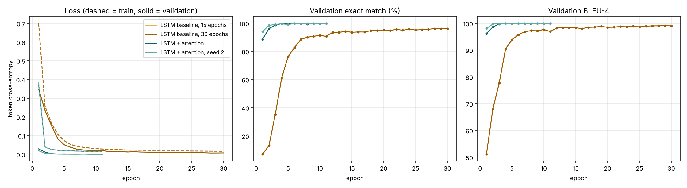
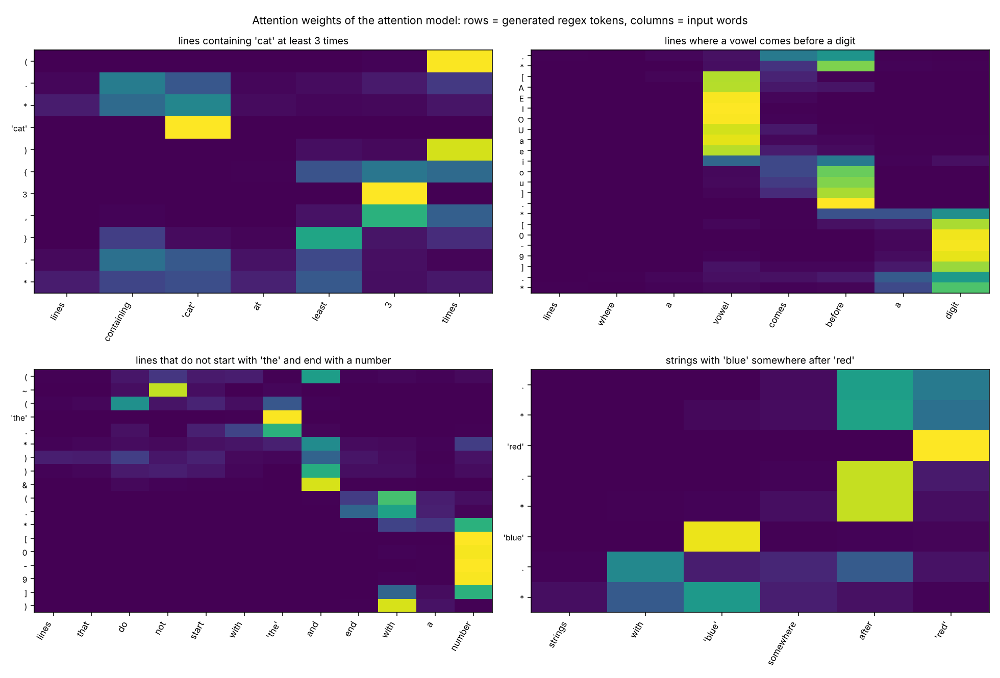

# From English to regular expressions: an encoder-decoder with attention, trained on a verified dataset

NLP course project, text generation with encoder-decoder architectures. Mohamed Ali Aoun.
All numbers below come from the code and logs in this repository (`results/`, `logs/`).

## 1. Introduction

**Task.** Natural language to regular expression. The input is a short English description of a set of text lines; the output is a regular expression that matches exactly those lines (the regex must match the whole line).

    lines containing 'cat' at least 2 times       ->   (.*cat){2,}.*
    lines containing 'cat' 2 times in a row       ->   .*(cat){2,}.*
    lines that start with a capital letter and end with a number   ->   ([A-Z].*)&(.*[0-9])

**Motivation.** Regexes are compact, precise and hard to write, while describing the wanted lines in words is easy. The output language is small and fully formal, so a generated regex can be checked by running it, which allows an evaluation that goes beyond string comparison, and failures are easy to interpret.

**Formulation.** Given a source token sequence x = (x_1 ... x_n), generate a target token sequence y = (y_1 ... y_m) by maximising p(y | x) = prod_t p(y_t | y_<t, x). Source tokens are words; target tokens are regex symbols.

**Contribution in one sentence.** We first trained on the standard benchmark (NL-RX) and found that some of its labels contradict their English; we therefore built VeriRegex, a generated dataset in which every label is verified by an independent implementation, and show that an LSTM encoder-decoder with attention learns it almost perfectly on new regexes (99.4% exact match) and still well on held-out sentence patterns (82.6%) and handwritten descriptions (48 of 50).

## 2. Related concepts

- **Encoder-decoder (Sutskever et al., 2014).** An encoder RNN reads the input and compresses it into a state; a decoder RNN starts from that state and emits the output one token at a time, each step conditioned on the previous token.
- **Attention (Bahdanau et al., 2015).** A single fixed-size vector must carry the whole sentence, which becomes a bottleneck for long or detail-heavy inputs. Attention lets the decoder look back at all encoder states at every step and weight them.
- **Placeholders for rare tokens.** Copying arbitrary literal words through a fixed vocabulary is impossible, so literals are replaced by numbered slots before the model sees them and restored afterwards (a standard technique in semantic parsing; NL-RX itself uses four fixed stand-in words).
- **This task in the literature.** Locascio et al. (2016) introduced NL-RX (10,000 pairs, crowd paraphrases of templated descriptions) and a seq2seq model with attention, reporting 58.2% accuracy on NL-RX-Turk and 88.7% on the templated NL-RX-Synth under DFA equivalence.

## 3. Dataset

### 3.1 Why we did not keep NL-RX

Our first version trained on NL-RX-Turk and reached 45.3% exact match and 65.1% functional accuracy (the archived run is in `results/nlrx_v1/`). Inspecting the outputs showed that the benchmark's labels do not always mean what the English says. Example from the data:

    lines with the string 'dog' at least 2 times   ->   .*(dog){2,}.*

This regex accepts `dogdog` but rejects `dog and dog`, although that line contains "dog" twice: the label means "two adjacent copies". The templated version NL-RX-Synth uses the same convention ("lines containing the string 'dog', 2 or more times" has the same regex), so the problem is in the original grammar, not in the crowd paraphrases. A model trained on such data is graded against labels a human reader would call wrong, and its errors become hard to interpret. Other public datasets are either very small (KB13, about 800 pairs) or much harder to learn without pretraining (StructuredRegex, about 3,500 pairs).

### 3.2 VeriRegex: generated and verified

We wrote a generator (`src/generate.py`) that builds each example from one **meaning tree** and derives everything else from it:

1. **Meaning tree.** 13 kinds of condition: contains, starts with, ends with, is exactly, at least N times, fewer than N times, N times in a row, before, immediately followed by, length at least / at most / exactly N, made only of. They apply to a quoted literal or to a character type (digit, letter, capital, lowercase, vowel, space) and are combined with not, and (two or three conditions) and or.
2. **English.** One description is written from the tree by choosing among 216 phrasing templates (verb phrases, participles, "where ..." clauses, singular and plural subjects), synonyms ("a digit", "a number", "a numeral"), openers ("find", "give me", "a regex for"), shared-verb coordination ("contain 'a' and 'b'") and reorderings ("'blue' somewhere after 'red'"). Literals are drawn from 135 words, names, numbers and two-word phrases.
3. **Regex.** One canonical regex per tree: `(.*cat){2,}.*` for "at least 2 times", `.*(cat){2,}.*` for "2 times in a row", `(A)&(B)`, `(A)|(B)`, `~(A)`.
4. **Verification.** The same tree is also evaluated by a plain Python predicate that never looks at the regex (for example `s.count('cat') >= 2`). On about 300 probe strings per example (built from the example's literals, their halves, upper-case variants, repetitions, random characters and every length from 0 to 22), the regex run through our matcher and the predicate must agree on every string. **A single disagreement stops the build**; none occurred. In addition, an example is kept only if some probe matches and some does not, which removes contradictions ("starts with a digit and starts with a letter") and tautologies: 5,251 of 47,251 sampled trees (11%) were rejected this way.

The dialect is the one of NL-RX: `.`, character classes, `*`, `+`, `{n}`, `{n,}`, `{n,m}`, grouping, `|`, plus `&` (intersection) and `~` (complement). Python's `re` has neither of the last two, so `src/regex_engine.py` implements a parser and whole-line matcher for the dialect.

### 3.3 Splits and statistics

| Split | Pairs | What it measures |
|---|---|---|
| Train | 37,586 | 14,345 distinct regex structures |
| Validation | 2,000 | model selection; regexes unseen in training |
| Test: new regexes | 1,884 | new combinations and parameters, in the training style |
| Test: new phrasings | 1,500 | 11 phrasing patterns never used in training (for example "have X at the end", "contain X no fewer than N times", "each line"), on new regexes |
| Test: handwritten | 50 | descriptions written by hand, in free wording |

- **Split by regex.** After removing duplicate (description, regex) pairs, the regex structures (with literals replaced by slots) are shuffled and assigned to train, validation or test, so no test regex appears in training. Single conditions all go to training, so the new-regex test consists of new combinations (1,031 AND, 597 OR, 236 negations; the 20 remaining single conditions all say "fewer than 5 capital letters", a condition whose regex happened to be drawn into the test split).
- **New phrasings.** Generated with the held-out templates allowed and kept only if at least one was used, the regex is new and the anonymised description is not in training. Most words of these patterns occur in training in other combinations; the only unknown word is "each" (0.7% of tokens).
- **Handwritten.** Fifty descriptions written by hand, with their meaning tree written by hand too, so their labels are verified like the others. They test wording, not structure: 46 of their 50 regexes also occur in training. 1.2% of their tokens are unknown ("word", "whose", "must", "be").
- **Lengths (train):** 13.9 source tokens on average (max 37), 16.9 target tokens (max 67).

## 4. Preprocessing

| Step | What we do | Why |
|---|---|---|
| Literal slots | each quoted span ('cat', "2024", 'ice cream') becomes `__w0__`, `__w1__`, ... in order of first appearance, in the description and in the regex; after decoding, slots are replaced by the literals (special characters escaped as `[.]`) | the model works with any word, including words never seen in training |
| Normalisation | lowercase, remaining quotes removed | smaller vocabulary |
| Source tokenisation | words (hyphenated words kept whole) and punctuation | descriptions mix words and punctuation |
| Target tokenisation | one token per regex character; `__wK__` and `\b` are single tokens | regex syntax is character-level |
| Vocabularies | from the training split only; `<PAD>`=0, `<UNK>`=1, `<SOS>`=2, `<EOS>`=3 | no information from the test sets |
| Padding | batches padded with `<PAD>`; packed sequences in the encoder, attention masks padded positions, the loss ignores `<PAD>` | variable-length batches |
| Truncation | at most 40 source and 60 target tokens | no source is truncated; 11 of 43,020 regexes are longer than 59 tokens and are cut (see section 9) |
| Unknown words | mapped to `<UNK>`; 5% of training words are randomly replaced by `<UNK>` (word dropout) | robustness to unseen words |

Vocabulary sizes: 198 source words, 44 target tokens. Embedding dimension 128 for both. Numeric representation: token ids, then a learned embedding layer.

## 5. Proposed architecture

Implemented in `src/models.py` with PyTorch layers (Embedding, LSTM, Linear) and our own attention, bridge and decoding code.

- **Encoder:** Embedding(198, 128) -> dropout -> LSTM (1 layer, hidden 256).
- **Initial decoder state:** the encoder's final (h, c), each passed through a linear layer and tanh (the "bridge").
- **Decoder, baseline:** Embedding(44, 128) -> LSTM(256) -> Linear(256 -> 44) -> softmax. Its only link to the input is the initial state.
- **Decoder, attention:** at each step, additive attention `score(s, h_i) = v^T tanh(W_s s + W_h h_i)`, softmax over source positions (padding masked), context = weighted sum of encoder states. The context is concatenated to the LSTM input, and the output layer sees [hidden state, context, previous-token embedding].
- **Prediction and stopping:** arg-max at each step (greedy), or beam search; generation stops at `<EOS>` or after 60 tokens.
- **Parameters:** baseline 964,396; attention 1,375,020.

## 6. Training and evaluation protocol

- **Loss:** token-level cross-entropy, padding ignored. **Optimiser:** Adam, learning rate 1e-3, halved after 2 epochs without validation-loss improvement, gradient clipping at 1.0.
- **Batch size 64**, dropout 0.3, word dropout 0.05, batches grouped by target length. **Teacher forcing** ratio 1.0 (the gold previous token is always fed in training).
- **Model selection:** epoch with the best validation exact match; early stopping after 4 epochs without improvement (6 for the long baseline). At most 15 epochs (30 for the long baseline, because the 15-epoch baseline was still improving).
- **Hardware:** CPU only (two cores, shared with other runs). Training time: 25 minutes for the attention model, 19 minutes for the 15-epoch baseline, 51 minutes for the 30-epoch baseline.

**Metrics.**

| Metric | Meaning | Why |
|---|---|---|
| Exact match (EM) | generated regex identical to the reference (in slot form) | strict: equivalent regexes written differently count as wrong |
| Same behaviour (functional accuracy) | generated regex accepts and rejects the same probe strings as the reference (about 600 strings built from the words dog, truck, ring that stand in for the slots, letters, digits, spaces and repetitions) | closer to what a user cares about |
| BLEU-4 | n-gram overlap on regex tokens | smooth diagnostic for near misses |
| Perplexity, token accuracy | teacher-forced diagnostics | compare models independently of decoding |
| Valid-regex rate | output parses as a regex | syntax errors |

## 7. Experimental results

Greedy decoding.

| Model | Params | Test set | n | Exact match (%) | Same behaviour (%) | BLEU-4 | Perplexity |
|---|---|---|---|---|---|---|---|
| LSTM baseline, 15 epochs | 964k | New regexes | 1,884 | 92.4 | 93.3 | 98.0 | 1.017 |
| | | New phrasings | 1,500 | 75.1 | 77.3 | 95.6 | 1.053 |
| | | Handwritten | 50 | 94.0 | 96.0 | 98.2 | 1.033 |
| LSTM baseline, 30 epochs | 964k | New regexes | 1,884 | 95.6 | 96.2 | 99.0 | 1.009 |
| | | New phrasings | 1,500 | 81.2 | 83.3 | 96.8 | 1.035 |
| | | Handwritten | 50 | 92.0 | 92.0 | 97.4 | 1.067 |
| **LSTM + attention** | 1.38M | New regexes | 1,884 | **99.4** | **99.4** | 99.9 | 1.002 |
| | | New phrasings | 1,500 | **82.6** | **84.3** | 97.4 | 1.039 |
| | | Handwritten | 50 | **96.0** | 96.0 | 97.6 | 1.038 |
| LSTM + attention, second seed | 1.38M | New regexes | 1,884 | 99.7 | 99.7 | 100.0 | 1.001 |
| | | New phrasings | 1,500 | 83.3 | 84.7 | 97.0 | 1.036 |
| | | Handwritten | 50 | 96.0 | 96.0 | 97.6 | 1.039 |

Valid-regex rate is 99.6 to 100% for every model and test set.

**By kind of description** (new-regex test set, exact match %): all models are perfect on single and negated conditions (256 examples). On AND combinations (1,031 examples) the baseline scores 88.1% after 15 epochs and 92.5% after 30, the attention model 99.4%; on OR combinations (597) the baselines score 96.6% and 99.0%, the attention model 99.0%.

**Learning curves** (`results/learning_curves.png`). The attention model reaches 88.7% validation exact match after one epoch and 99.75% after four (best 99.95% at epoch 7). The baseline needs 7 epochs to pass 88%, reaches 94.3% at epoch 14 and 96.3% at epoch 28, and is still creeping up at epoch 30. The two baseline runs use the same seed and follow exactly the same curve for their first 15 epochs, so the 15-epoch baseline is the first half of the 30-epoch run (its curve is hidden under the longer one in the figure). Training and validation losses stay close for both models (attention: 0.017 train, 0.0007 validation at the best epoch; validation is lower because dropout is active only during training), so there is no sign of overfitting on this data.

**Greedy versus beam search** (beam 5, length-normalised):

| Model | Test set | Greedy: exact / same (%) | Beam 5: exact / same (%) |
|---|---|---|---|
| Baseline, 15 epochs | New regexes | 92.4 / 93.3 | 92.7 / 93.5 |
| Baseline, 15 epochs | New phrasings | 75.1 / 77.3 | 75.1 / 77.5 |
| Baseline, 15 epochs | Handwritten | 94.0 / 96.0 | 96.0 / 96.0 |
| Attention | New regexes | 99.4 / 99.4 | 99.4 / 99.5 |
| Attention | New phrasings | 82.6 / 84.3 | 82.6 / 84.3 |
| Attention | Handwritten | 96.0 / 96.0 | 96.0 / 96.0 |

**Reading the results.**

1. **Attention is the decisive component for new regex structures.** Against the baseline trained for the same 15 epochs it removes nine tenths of the errors on new regexes (7.6% wrong down to 0.6%); against the baseline trained twice as long it still removes six in seven (4.4% down to 0.6%), with fewer epochs and less time. The baseline's errors concentrate in AND combinations, where one fixed-size vector has to carry two or three conditions with their literals and numbers (92.5% exact after 30 epochs, against 99.4%).
2. **Generalisation to new wording is the real difficulty, and here attention helps less.** On held-out sentence patterns, exact match falls to 82.6% for the attention model (83.3% for the second seed), against 75.1% for the 15-epoch baseline and 81.2% for the 30-epoch baseline. With enough training, the baseline nearly closes the gap: what limits both models on new wording is what they learned from the templates, not the architecture. The errors are analysed in section 9.
3. **Handwritten descriptions mostly work** (48 of 50 exact for the attention model, 47 and 46 of 50 for the two baselines); the two attention errors involve "no ... at all" and an AND written as a relative clause (section 8). With 50 examples, one example is 2 points, so these differences are not significant.
4. **Beam search changes little.** For the attention model it returns the greedy output in almost every case: its predictions are so confident that the best sequence is also the greedy one. For the baseline it adds 0.3 points on new regexes and one handwritten example. (A first version of our beam search stopped as soon as five hypotheses had ended, which could discard the best one and cost about 10 points of exact match; the corrected version stops only when no open hypothesis can still beat the best finished one.)
5. **Comparison with the first version.** On NL-RX the same architecture reached 45.3% exact match. The two numbers are not comparable as a measure of model quality, since the tasks differ, but the difference shows how much of that 45% came from noisy and ambiguous labels, which a model cannot learn to reproduce.

Attention visualisations (`results/attention_examples.png`) are interpretable: while writing the count `3` the decoder attends to "3" (and to "least" and "times" around it); each slot attends to its quoted literal; `~` attends to "not" and `&` to "and"; the character class `[AEIOUaeiou]` attends to "vowel"; and for "strings with 'blue' somewhere after 'red'" the decoder writes 'red' first, attending to the last word of the sentence, which is the required reordering.

## 8. Generated examples

Attention model, greedy decoding. Full lists in `results/qualitative_examples.md`. Literals are shown after slot replacement.

**Correct (new regexes)**

| Input | Output (= reference) |
|---|---|
| show me rows which never have an alphabetic character right before the substring 'Hello' and contain a vowel followed later by 's' | `(~(.*[A-Za-z]Hello.*))&(.*[AEIOUaeiou].*s.*)` |
| a regular expression for text lines that have exactly 20 characters and are longer than 3 characters | `(.{20})&(~(.{0,3}))` |
| a regex for lines in which the text doesn't begin with a digit and the text finishes with the substring 'report' | `(~([0-9].*))&(.*report)` |
| I want all strings where 'table' is repeated 4 times in a row and the length is at least 9 (new phrasing) | `(.*(table){4,}.*)&(.{9,})` |

**Handwritten**

| Input | Output | |
|---|---|---|
| lines where 'cat' shows up at least twice | `(.*cat){2,}.*` | correct |
| lines in which 'price' comes before 'total' | `.*price.*total.*` | correct |
| lines where 'blue' comes somewhere after 'red' | `.*red.*blue.*` | correct, literals reordered |
| lines with no digits at all | `.{0,9}` | wrong: "no ... at all" never occurs in training ("without", "do not contain" do) |
| lines of at most 10 characters that contain a digit | `(.{0,10})\|(.*[0-9].*)` | wrong: AND expressed as a relative clause became OR |

**Failures on held-out phrasings**

| Input | Reference | Generated | What went wrong |
|---|---|---|---|
| ... have the sequence "Alice" at the end but do not contain a space | `(.*Alice)&(~(.* .*))` | `(Alice.*)&(~(.* .*))` | held-out "have X at the end" read as "at the start" |
| ... contain the substring 'zero' no fewer than three times and ... | `((.*zero){3,}.*)&...` | `(~((.*zero){3,}.*))&...` | "no fewer than" read as "fewer than": negation flipped |
| ... have a capital at the end and also is longer than seven characters | `(.*[A-Z])&(~(.{0,7}))` | `(.*[A-Z].*)&(~(.{0,7}))` | "at the end" read as "contains" |
| ... contain a capital letter with the substring 'paper' right after ... | `(.*[A-Z]paper.*)&...` | `(.*paper.*[A-Z].*)&...` | held-out "with Y right after" confused with "Y after X" and the order inverted |

## 9. Discussion

**Does the model learn the task?** On the distribution it was trained on, yes: 99.4% of regexes never seen in training are generated exactly, BLEU is 99.9 and outputs are valid regexes 99.9% of the time. The remaining 11 errors (of 1,884) are instructive. Six are the same structure, "ends with X or Y" (`(.*X)|(.*Y)`), which is absent from training because of the split by regex: the model writes the second ending as "contains" (`(.*Y.*)`), the shape it has seen in "contains X or Y". Two are outputs cut at the 60-token limit (both references are longer than that), and the last three drop or alter one condition of a long description.

**Where it fails.** Error types on the new-phrasing test (attention model, 235 wrong outputs, all valid regexes): 68 have a missing or extra negation, 8 a wrong character class, 3 only a wrong number, and 156 another structural error, most of which are a condition read as a different one (for example "at the end" as "contains" or "starts with"). These are exactly the held-out templates: the model has not learned the meaning of words like "end" independently of the construction they appeared in during training; it has learned constructions. "No fewer than N" is a clear example: the words "no" and "fewer than" both occur in training, and the model follows "fewer than".

**Why.** The training sentences come from templates, so the model sees each condition in a limited set of constructions; within those it is nearly perfect, but recombining known words into a new construction is only partly learned. This is a known weakness of sequence-to-sequence models trained from scratch on synthetic data, and the reason we report the held-out-phrasing and handwritten sets next to the in-distribution one.

**Strengths.** Small model, CPU training in under half an hour, interpretable attention, no pretrained component, valid syntax, any literal word (slots), and labels that are verified rather than assumed.

**Limitations.**
- *Synthetic language.* Template sentences are more regular than human writing; the 99.4% figure is an in-distribution number. The held-out-phrasing and handwritten sets are the more honest estimates, and the handwritten set is small (50) and mostly simple.
- *Behavioural equivalence is a sampling test.* We found one false "equivalent": for "a line containing three consecutive copies of 'light' and also lacking a number" the model wrote `~(.*[0-9].*[0-9].*)` ("fewer than two digits") instead of `~(.*[0-9].*)`, and none of the 600 probe strings has three copies of the literal and exactly one digit. Exact match is reliable here because the generator writes one canonical regex per meaning.
- *Canonical order.* Exact match counts `(A)&(B)` and `(B)&(A)` as different; the generator always follows the order of the description, so this rarely matters (one handwritten example).
- *Length limit.* 60 target tokens; 11 training regexes are longer and are truncated.
- *Seeds and training length.* The 30-epoch baseline was still improving slightly at its last epoch, so a longer run could narrow the gap further. The attention model was trained with two seeds (99.4 and 99.7% on new regexes, 82.6 and 83.3% on new phrasings, 96% on handwritten for both), so its results are stable to within about one point; the baselines have one seed each. The first seed is the one reported in the main text and used on the website.

**Possible improvements.** Paraphrasing the generated sentences (by people, or with a model for data creation only) to bring the training language closer to real requests; more constructions per condition; a copy mechanism instead of slots for unquoted literals; tree-structured or grammar-constrained decoding; exact DFA-based equivalence instead of probe strings.

## 10. Conclusion

A from-scratch LSTM encoder-decoder with additive attention translates English descriptions into regular expressions. Training it on a dataset whose labels are verified, rather than on a benchmark whose labels sometimes contradict their English, changes the picture: the attention model generates 99.4% of unseen regexes exactly, 82.6% on sentence patterns held out of training and 48 of 50 handwritten descriptions. The same network without attention, trained twice as long, reaches 95.6%, 81.2% and 46 of 50. Attention is the component that matters most for new combinations of conditions and for training speed; on new wording both models are limited by the templates they learned from. The main remaining weakness is new wording, especially negation words in unfamiliar constructions. Lessons learned: check the labels before trusting a metric, and always test on a distribution other than the one the data generator produces.

**Reproducibility.** `README.md` lists the commands. `python src/generate.py` rebuilds the dataset deterministically; every run's configuration, learning curve, checkpoint and test predictions are in `results/<run>/`.

## References

- Locascio, Narasimhan, DeLeon, Kushman, Barzilay. *Neural Generation of Regular Expressions from Natural Language with Minimal Domain Knowledge.* EMNLP 2016. <https://arxiv.org/abs/1608.03000>
- Sutskever, Vinyals, Le. *Sequence to Sequence Learning with Neural Networks.* NeurIPS 2014.
- Bahdanau, Cho, Bengio. *Neural Machine Translation by Jointly Learning to Align and Translate.* ICLR 2015.
- Ye, Chen, Wang, Dillig, Durrett. *Benchmarking Multimodal Regex Synthesis with Complex Structures.* ACL 2020 (StructuredRegex).
